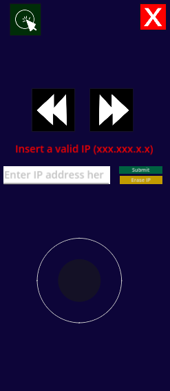

# Presentation remote
Who needs to buy a remote for their PowerPoint presentation when you can make your own with Godot!?

## Introduction
The Presentation remote is a mobile app that connects to your PC/Laptop using UDP connection via localhost; Allowing you to have an easier experience with presenting things in PowerPoint. Similar to how Instructors have a remote/Laser pointer that they use for their presentations, you can also use this app to simulate the remotes albeit with less accuracy. you can move the mouse, move to the next or previous slide, left click and quit your slideshow without even touching your laptop.

## Tech stack and prerequisites
### Programming
- <b>Mobile App buttons and Client Side:</b>
<br>  <br>
- <b>Backend Server for processing requests and input handling:</b>
<br>  <br>

> [!NOTE]
> Godot has to be version 4.6 Or higher

### Prerequisites
- Android NDK and SDK <br>
- Virtual Joystick plugin for Godot <br>
- System32.dll library for C# <br>

## The Project
### The Concepts
1- <b>Networking:</b> This system utilizes UDP connection as speed is far more important than a stable connection. <br>
2- <b>Data transfer:</b> This system uses a custom fixed-length binary protocol transmitted over UDP. Transferring a 9 byte buffered number instead of JSON. Unlike JSON, this solution is faster due to the fact we are not going to deal with serialization/deserialization overhead and we are going to avoid bandwidth of JSON due to us omitting human-readable aspect of data transferring because this solution transfers data at a fairly low level. We also avoid JSON bugs such as empty JSONs and such since a malformed package can be omitted.

This number can be split into 3 sections:
The MSB is anything that has nothing to do with the joystick coordinates. namely the main requests. the 4 bytes after the MSB are the X coordinates of the stick and the last 4 are for the Y coordinates of the stick. here's a schematic:
~~~
┌────────────┬──────────────────┬──────────────────┐
│   Command  │        X         │        Y         │
│   1 byte   │     4 bytes      │     4 bytes      │
│   8 bits   │     32 bits      │     32 bits      │
└────────────┴──────────────────┴──────────────────┘
~~~

There are Enums in both parts of the project that determine the request type. They are as follows: <br>
~~~
        Joystick = 1 => for setting the C# script up to pay attention to the X and Y coordinates and send them to the Mouse cursor. 
        PrevSlide = 2 => to trigger the previous button aka the left arrow key.
        NextSlide = 3 => to trigger the next button aka the right arrow key.
        Click = 4 => to trigger the left click.
        Quit = 5 => to trigger the escape button.
~~~
Note that as you see above, the 9 byte number is binary.

### Godot side

<br>
This side of the project focuses on the frontend aspect. This side utilizes a monolithic script in which all the following actions happen: <br>
1- IP address validation using regex. <br>
2- Sending the right request as a 9 byte number. <br>
3- Button signal management.

There are multiple buttons to use: <br>
1- The red button with a white cross which acts as the ESC key. (more on this in the C# section further down) <br>
2- The green button which acts as the left click. <br>
3- The left and right buttons which act as the left and right arrow keys. <br>
4- The joystick which is responsible for mouse movement. <br>
5- The textbox which is where you type your IP address. (use ipconfig to find the IP address of your system) <br>
6- The green submit button which sends the content typed inside the textbox to be validated as a valid IP using regex. <br>
7- The erase button to remove your IP address from the system. 
> [!NOTE]
> Your IP address will not be saved anywhere and you have to type it manually each time that you want to use the app.

> [!IMPORTANT]
> Make sure you have downloaded and set up the [Virtual Joystick package for Godot](https://godotengine.org/asset-library/asset/1787) as the engine does not have Joystick support by default. The project itself does have this within the addons directory but in case things go wrong, you can go to the link earlier in this paragraph.

> [!TIP]
> Within the path of Project > Project Settings > Input Devices > Pointing inside of Godot:
> For testing make sure to turn on Emulate touch from mouse and turn off Emulate mouse from touch.
> For Exporting and publishing make sure to turn on Emulate mouse from touch and turn off Emulate touch from mouse.

### The C# side
This side of the project focuses on receiving the 9 byte number, processing and at last turning it into a Keyboard/Mouse input.
In this part of the project the following happens:
1- Receiving the 9 byte number and breaking it into the aforementioned 3 parts.
2- Checking the MSB for the right action.
3- In case the control stick moved, translate it's coordinates and move the mouse cursor accordingly.
4- Using the user32.dll library in order to gain access to low level OS tasks such as pressing certain keys on the keyboard or moving the mouse without pressing any key or moving the actual mouse.

> [!IMPORTANT]
> Since the Server won't shut down properly and you can't stop the server when it is running, you have to find the Process that is responsible for keeping the port of this app and not releasing it. once found, you have to kill that process. (See the Comment at the end of the ```Server.cs``` script for more detail)

## Project Architecture
~~~
+---new-game-project
|   +---addons
|   |   \---virtual_joystick
|   |       +---previews
|   |       +---test
|   |       \---textures
|   +---Icons
|   \---Scenes_and_Scripts
\---Server Script
~~~
- <b>addons:</b> the directory where your custom non-default godot plugins reside such as the virtual joystick plugin. <br>
- <b>Icons:</b> where the graphical icons of the project are. <br>
- <b>Scenes_and_Scripts:</b> Godot uses a scene hierarchy to create its main scenes. similar to how in Flutter everything is a widget, in Godot, everything is a scene. this is the folder where scenes (.tscn files) and their attached scripts (.gd files) are held. Note that there is a lot of small .gd script files. these are pretty much obsolete and are for an older version of the project that used smaller scripts and relied more on Godot Signals. The main script that you are going to be focusing on is going to be ```remote_handler.gd``` . <br>
- <b>Server Script:</b> the directory where the C# server lies in.

## How can i contribute?
To contribute you need: Godot Engine, C#, Android SDK and NDK and the Virtual Joystick plugin for Godot game engine. once you have all these, you are ready to start the project. <br>
Export the project from Godot first. then send it to your phone and make sure you install it. Do not worry if phone security checks say this app is dangerous. it is not.
feel free to fork and add your own features or polish things.
### Things that i suggest to add or improve on: 
- Better Joystick control. specially when the stick is not fully tilted
- More responsive joystick control
- A Soundboard
- More Computer inputs such as the Enter key or right click and so on
- Better button designs
- Making the cursor Vanish when you release the control stick and making it reappear when you want to move the cursor using the stick.
- Removing the issue with the server not shutting down properly (see the end of the C# side section in this README file)
- Adding better security and fixing the erase button as it currently is not working properly.
- Whatever that doesn't kill the main purpose of the project which is to create a PowerPoint presentation remote.

## Credits:
- Icon Artist, Programming, Project concept, Tester and Designer: MohammadAmin "Bamdad" Rashidi <br>
- Extra help, advice, polish and co-programmer: LLMS <br>
- Small suggestion that changed the whole project for the better: Mr. KNF
